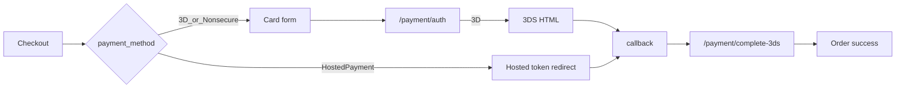

# Uannes — NetGSM ve TAMI Entegrasyon Dokümanı

OpenCart projesi için NetGSM (SMS) ve TAMI (ödeme) entegrasyon referansı. Kod yazımı veya canlı kurulum bu dokümanın kapsamı dışındadır; mevcut durum, API spesifikasyonu ve aktivasyon checklist’i yer alır.

---

## 1. Genel durum özeti

| Entegrasyon | Durum | Not |
|---|---|---|
| **NetGSM** | Canlı kod yok | Yalnızca test log’u ve orphan `oc_event` kaldı |
| **TAMI** | Paket hazır, kurulu değil | Dosyalar tmp upload altında; canlı `admin/` / `catalog/` içinde yok |
| **Aktif ödemeler** | COD / free checkout | TAMI extension kayıtlı değil |

**Sonuç:** İkisinde de “yalnızca API anahtarı girmek” yeterli değildir. NetGSM için modülün yeniden eklenmesi; TAMI için paketin canlıya kurulup etkinleştirilmesi gerekir.

---

## 2. NetGSM (SMS)

### 2.1 Amaç

Sipariş durumu değiştiğinde müşteri telefonuna SMS göndermek (`addOrderHistory` sonrası).

### 2.2 Mevcut izler

| Kaynak | Açıklama |
|---|---|
| [`system/storage/logs/netgsm_test.log`](../system/storage/logs/netgsm_test.log) | TEST MODE SMS kayıtları (Ekim 2025) |
| `system/storage/logs/error.log` | `[NetGSM] Order N SMS response: {"success":true,"raw":"TEST MODE - No API call made"}` |
| DB `oc_event` (beklenen) | Orphan hook — controller diskte yok |

**Orphan event (beklenen kayıt):**

| Alan | Değer |
|---|---|
| Trigger | `catalog/model/checkout/order/addOrderHistory/after` |
| Action | `extension/module/netgsm_send/orderStatusChanged` |

Canlı `admin/`, `catalog/`, `system/library/` altında `netgsm` PHP/twig dosyası yoktur. `oc_setting` / `oc_extension` NetGSM satırı da beklenmez.

### 2.3 Önerilen OpenCart modül iskeleti

```
admin/controller/extension/module/netgsm_send.php
admin/language/tr-tr/extension/module/netgsm_send.php
admin/language/en-gb/extension/module/netgsm_send.php
admin/view/template/extension/module/netgsm_send.twig
catalog/controller/extension/module/netgsm_send.php   # orderStatusChanged()
catalog/model/extension/module/netgsm_send.php        # sendSms() / curl (opsiyonel)
```

**Install sırasında event kaydı:**

| Alan | Değer |
|---|---|
| code | `netgsm_send` |
| trigger | `catalog/model/checkout/order/addOrderHistory/after` |
| action | `extension/module/netgsm_send/orderStatusChanged` |

**`orderStatusChanged($route, $args)` akışı:**

1. `$args` içinden `$order_id`, `$order_status_id` al
2. Siparişi yükle → telefon, ad, ürün(ler)
3. Test modundaysa `netgsm_test.log`’a yaz, API çağırma
4. Değilse REST v2’ye POST et; cevabı `error.log`’a yaz
5. Duruma göre mesaj şablonu seç

### 2.4 API spesifikasyonu

Referans implementasyon: sibling Laravel projeleri (`gold.dijicrea.net`, `dailygood.dijicrea.net`) — `SmsService` REST v2.

| Alan | Değer |
|---|---|
| Method | `POST` |
| URL | `https://api.netgsm.com.tr/sms/rest/v2/send` |
| Auth | HTTP Basic (`username` / `password`) |
| Content-Type | `application/json` |

**Request body örneği:**

```json
{
  "msgheader": "<HEADER>",
  "messages": [
    {
      "msg": "SMS metni",
      "no": "905XXXXXXXXX"
    }
  ],
  "encoding": "TR"
}
```

**Başarılı yanıt örneği:**

```json
{
  "code": "00",
  "jobid": "...",
  "description": "queued"
}
```

> Not: Eski `bulkhttppost.asp` / GET `/sms/send/get` yerine REST v2 tercih edilmelidir.

### 2.5 Config anahtarları (önerilen)

OpenCart `oc_setting` grubu: `module_netgsm_send`

| Anahtar | Açıklama |
|---|---|
| `module_netgsm_send_status` | Modül açık/kapalı |
| `module_netgsm_send_username` | NetGSM kullanıcı adı |
| `module_netgsm_send_password` | NetGSM şifre / API şifresi |
| `module_netgsm_send_header` | SMS başlığı (`msgheader`) |
| `module_netgsm_send_api_url` | Varsayılan: REST v2 URL |
| `module_netgsm_send_test_mode` | `1` = API çağırma, log’a yaz |
| `module_netgsm_send_test_phone` | Test modunda hedef numara (opsiyonel) |
| Durum bazlı şablonlar | Alındı / iptal / kargo / tamamlandı / generic |

### 2.6 Mesaj şablonları (log’lardan)

Kaynak: `netgsm_test.log` (Order `#7`, TEST MODE).

| Tip | Şablon |
|---|---|
| Generic (erken) | `Sayın {name}, #{order_id} numaralı sipariş durumunuz güncellendi.` |
| Generic + ürün + durum | `Sayın {name}, '{product}' siparişinizin durumu '{status}' olarak güncellenmiştir.` |
| Alındı | `Sayın {name}, siparişiniz başarıyla alınmıştır. Teşekkür ederiz!` |
| İptal | `Sayın {name}, siparişiniz iptal edilmiştir. Üzgünüz, destek ekibimiz sizinle iletişime geçecektir.` |
| Kargo | `Sayın {name}, siparişiniz kargoya verilmiştir. En kısa zamanda elinizde olacaktır.` |
| Tamamlandı | `Sayın {name}, siparişiniz tamamlandı. Güle güle kullanın!` |

Log’da görülen durum isimleri (örnek): Canceled, Expired, Beklemede, İptal Edildi, Processed, İade Edildi, Kargoya Verildi, Geçersiz.

### 2.7 NetGSM kurulum checklist

- [ ] `extension/module/netgsm_send` dosyalarını oluştur / geri ekle
- [ ] Admin’den modülü kur (`install`) — `oc_event` kaydını oluştur
- [ ] Orphan event varsa düzelt veya yeniden kaydet (eksik controller’a işaret etmesin)
- [ ] Username, password, msgheader ayarla
- [ ] Test mode açıkken sipariş durumu değiştir → `netgsm_test.log` doğrula
- [ ] Test mode kapat → gerçek SMS (küçük numara listesiyle) doğrula
- [ ] Modülü Extensions → Modules altında etkinleştir

---

## 3. TAMI (ödeme)

### 3.1 Amaç

Checkout’ta kredi kartı / 3D Secure / Hosted Payment ile ödeme almak; iade ve taksit yönetimi.

### 3.2 Paket konumu

Resmi OpenCart paketi (kurulmamış extract):

```
system/storage/upload/tmp-8da1eAmtox/upload/
├── admin/controller|model|language|view/.../payment/tami*
└── catalog/controller|model|language|view/.../payment/tami*
    └── catalog/controller/extension/payment/Tami/
        ├── TamiPaymentClient.php
        ├── HashGenerator.php
        ├── ModuleSettings.php
        └── Requests/...
```

Canlı yollarda (`admin/controller/extension/payment/tami.php`, `catalog/...`) **yok**.  
`oc_extension` / `payment_tami_*` ayarları / `oc_tami_order_meta` tablosu beklenmez.

Paket içinde README yoktur. Harici referanslar (paket UI): `https://docs.gri.info/tami`, `https://portal.tami.com.tr`.

### 3.3 Canlıya kurulum

1. `tmp-8da1eAmtox/upload/` içeriğini proje köküne kopyala (`admin/` + `catalog/` birleştir) **veya** Extension Installer ile zip yeniden yükle
2. Admin → Extensions → Payments → **TAMI** → Install
3. Install şunları yapar:
   - Event `tami_left_menu` → `admin/view/common/column_left/before`
   - Event `tami_global_header` → `admin/view/common/header/before`
   - `{DB_PREFIX}tami_order_meta` tablosunu oluşturur
4. Extension’ı Enable et; API / modül / taksit sekmelerini doldur

Uninstall: event’leri siler; meta tabloyu **drop etmez**.

### 3.4 Admin ayar anahtarları (OC3)

Grup: `payment_tami` — efektif anahtarlar `payment_tami_*`.

| Ayar grubu | Alanlar |
|---|---|
| `payment_tami_api_settings` | `environment`, `payment_method`, `merchant_id`, `terminal_id`, `secret_key`, `fixed_kid_value`, `fixed_k_value` + `*_test` varyantları |
| `payment_tami_installment_settings` | `enabled`, `minimum_amount`, oranlar `2`…`12` (`-1` = kapalı) |
| `payment_tami_module_settings` | `enabled`, `title`, `order_status`, `order_status_refund`, `order_status_failed`, `debug_mode`, `save_failed_transactions`, `checkout_order` |
| `payment_tami_module_extra` | `application_dismiss` |
| `payment_tami_status` | Checkout görünürlüğü (`getMethod()` > 0 ister) |

**Ortam:** `environment` = `test` | `prod`  
- `test` → `*_test` credential alanları  
- `prod` → canlı alanlar  

**Ödeme yöntemleri** (`payment_method` / `payment_method_test`):

| Değer | Davranış |
|---|---|
| `3D` | 3D Secure (iframe HTML) |
| `Nonsecure` | 3DS’siz auth |
| `HostedPayment` | Portal hosted sayfa redirect |

### 3.5 API host’ları ve path’ler

Kaynak: `catalog/controller/extension/payment/Tami/TamiPaymentClient.php`

| Sabit | URL |
|---|---|
| TEST_ENV_HOST | `https://sandbox-paymentapi.tami.com.tr` |
| PROD_ENV_HOST | `https://paymentapi.tami.com.tr` |
| TEST_HOSTED_BASE_URL | `https://sandbox-portal.tami.com.tr/hostedPaymentPage` |
| PROD_HOSTED_BASE_URL | `https://portal.tami.com.tr/hostedPaymentPage` |

**Auth header (her istek):**

```
PG-Auth-Token: {merchantId}:{terminalId}:{base64(sha256(merchantId+terminalId+secretKey))}
correlationId: tami_{rand}_{time}_{rand}
PG-Api-Version: v2
```

Payload imzası: `HashGenerator` + `fixed_kid_value` / `fixed_k_value` (JWK tarzı).

| Client metodu | Path | Amaç |
|---|---|---|
| `generateOneTimeHostedToken` | `/hosted/create-one-time-hosted-token` | Hosted URL `?token=` |
| `authRequest` | `/payment/auth` | Kart auth |
| `callback` → complete | `/payment/complete-3ds` | 3DS sonrası |
| `installmentQuery` | `/installment/bin-info` | Bağlantı / BIN kontrol |
| `getInstallmentInfo` | `/installment/installment-info` | Taksit seçenekleri |
| `refund` | `/payment/reverse` | İade / reverse |

Admin `api_validate`: örnek BIN `55496012` ile bağlantı testi.

### 3.6 Catalog route’lar

| Route | Rol |
|---|---|
| `extension/payment/tami` | Checkout UI / hosted redirect |
| `extension/payment/tami/make_payment` | Kart + taksit → auth |
| `extension/payment/tami/installment` | GET `bin`, `amount` → JSON oranlar |
| `extension/payment/tami/callback` | 3DS / hosted dönüş (POST) |

**Order meta anahtarları:** `card_info`, `installment`, `payment_amount`, `transaction_id`, `payment_completed_time`, `test_environment_payment` (test ise).

### 3.7 Checkout akışı



1. **HostedPayment:** `index()` → one-time token → portal redirect; dönüş `callback`
2. **3D / Nonsecure:** kart formu (`payment.twig` + popup)
3. **`make_payment`:** kart doğrula → taksit oranı → `authRequest`  
   - 3D: `threeDSHtmlContent` iframe  
   - Nonsecure başarı: `tami_order_success`
4. **`callback`:** hash kontrol → `/payment/complete-3ds` → başarıda `checkout/success`, aksi halde sepet + opsiyonel failed history

### 3.8 `tami_order_meta` şeması

Install SQL (admin model):

```sql
CREATE TABLE IF NOT EXISTS `{DB_PREFIX}tami_order_meta` (
  `id` INT(11) NOT NULL AUTO_INCREMENT,
  `order_id` INT(11) NOT NULL,
  `meta_key` varchar(255) NOT NULL,
  `meta_value` varchar(255),
  PRIMARY KEY (`id`)
) ENGINE=MyISAM DEFAULT CHARSET=utf8 COLLATE=utf8_general_ci;
```

### 3.9 Faydalı admin route’lar

| Route | Rol |
|---|---|
| `extension/payment/tami` | Panel |
| `extension/payment/tami/save_tami_options` | Ayar kaydet |
| `extension/payment/tami/api_validate` | API bağlantı testi |
| `extension/payment/tami/order` | Sipariş sekmesi widget |
| `extension/payment/tami/refund` | İade |

### 3.10 TAMI aktivasyon checklist

- [ ] Paketi `tmp-8da1eAmtox/upload/` içinden canlı `admin/` + `catalog/` altına kopyala / installer ile kur
- [ ] Payments → TAMI → Install (`tami_order_meta` + event’ler)
- [ ] Extension’ı Enable et (`payment_tami_status`)
- [ ] Test ortamı credential’larını gir; `api_validate` çalıştır
- [ ] `payment_method` seç (önerilen başlangıç: `3D` veya `HostedPayment`)
- [ ] Sipariş status’lerini ayarla (success / failed / refund)
- [ ] Taksit ayarlarını yapılandır (gerekirse)
- [ ] Sandbox ile test siparişi / callback doğrula
- [ ] Prod credential + `environment=prod` ile canlıya al

---

## 4. Credential checklist (canlı öncesi)

Secret değerler bu dokümana yazılmaz; portal / NetGSM panelinden alınır.

### NetGSM

| Alan | Kaynak |
|---|---|
| Username | NetGSM paneli |
| Password / API şifresi | NetGSM paneli |
| Msgheader (onaylı başlık) | NetGSM paneli |
| Test telefonu | İç kullanım |

### TAMI

| Alan | Ortam | Kaynak |
|---|---|---|
| `merchant_id` | test + prod | TAMI / Gri portal |
| `terminal_id` | test + prod | TAMI / Gri portal |
| `secret_key` | test + prod | TAMI / Gri portal |
| `fixed_kid_value` | test + prod | TAMI / Gri portal |
| `fixed_k_value` | test + prod | TAMI / Gri portal |
| `payment_method` | test + prod | Admin ayarı |
| Order status ID’leri | — | OpenCart sipariş durumları |

---

## 5. İlgili ama kapsam dışı

[`test/`](../test/) altındaki Param POS örnekleri TAMI değildir; ayrı sağlayıcıdır ve `vendor/autoload.php` olmadan çalışmaz.

---

## 6. Özet

| Entegrasyon | Kod durumu | Kalan iş |
|---|---|---|
| **NetGSM** | Eksik (yeniden yazılacak) | Modül + event + config + API credential |
| **TAMI** | Paket tam, canlıda yok | Kopyala/kur + enable + config + API credential |
